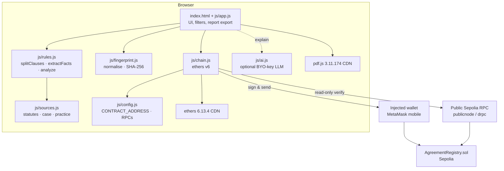
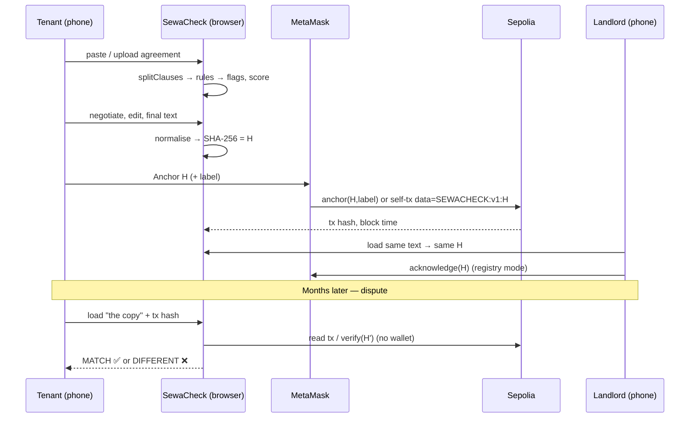

# SewaCheck — Architecture

## Design goals

1. **Runs on a cheap Android phone, offline-first.** Static files only; no server, no build step, no account. Hosted on GitHub Pages.
2. **Transparent, not a black box.** Every flag comes from a readable rule with cited sources. No paid API or key is needed.
3. **Private by default.** The agreement never leaves the device. Only a 32-byte hash (and an optional short label) can go on-chain, and only when the user chooses.
4. **Honest about the law.** Statute vs. case law vs. market practice are labelled separately; the draft Residential Tenancy Act is shown as *not in force*.

## Components

## Data flow

## Rule engine (`js/rules.js`)

- **Clause splitting.** Lines starting with `1.`, `1.1`, `Clause 3`, etc. start a clause; ALL-CAPS short lines become section headings; dates like `1.11.2026` are ignored. If fewer than three numbered clauses are found, the text is split into paragraphs instead (sample 3 tests this).
- **Fact extraction.** Monthly rent, security/utility deposit (RM or "N months"), term length and refund period are parsed from sentences, and deposit ratios are computed (e.g. RM5,400 / RM1,800 = 3 months).
- **Clause rules (21).** Each is `{ id, severity, title, bm, test(text, ctx), explain, sources[], suggest }`. `test` uses trigger regexes plus *mitigating* regexes to avoid false positives (e.g. entry "at any time" is flagged, but "24 hours' prior written notice, save in an emergency" is not; "through proceedings in court" suppresses the eviction flag). Some rules adjust severity from context (late interest > 24% p.a. → high; mutual termination → low; house-rules-only amendment → medium).
- **Document checks (6).** Deposit above market, utility deposit above 1 month, no refund deadline, refund > 45 days, no stamping clause, no inventory.
- **Positive signals (7).** Fair wear and tear excepted, entry notice, refund deadline, stamping, inventory, court process acknowledged, fair early-termination route.
- **Scoring.** 100 − (15 × high + 7 × medium + 3 × low), floored at 0. A ≥ 85, B ≥ 70, C ≥ 50, D below.
- **Overlap handling.** A clause flagged for early-exit forfeiture is not double-flagged as general deposit forfeiture.

The engine is UMD, so the same file runs in the browser and in Node tests (`scripts/test.js`).

## Fingerprint (`js/fingerprint.js`)

Normalisation spec `sewacheck-norm-v1`: NFKC → remove zero-width/BOM → curly quotes to straight, dashes to `-` → collapse all whitespace to one space → trim. Content (words, numbers, punctuation, case) is untouched. SHA-256 uses WebCrypto, with a tested pure-JS fallback for old WebViews or non-secure contexts. The output `0x…` is the `bytes32` the contract stores. Test vector: `sha256("hello") = 0x2cf24d…9824`, shared by the JS and Solidity tests.

## Smart contract (`contracts/src/AgreementRegistry.sol`)

| Function | Notes |
|---|---|
| `anchor(bytes32 hash, string label)` | Reverts on zero hash, label > 64 bytes, or if already anchored (first anchor wins). Stores anchorer, timestamp, block number, label. Emits `Anchored` and `Acknowledged` (anchorer counts as first acknowledgement). |
| `acknowledge(bytes32 hash)` | Counter-party confirms the same version. Reverts if not anchored or already acknowledged. |
| `verify(bytes32 hash) view` | `(exists, anchorer, timestamp, blockNumber, label)` |
| `hasAcknowledged(hash, party)`, `acknowledgementCount(hash)` | Views |

No owner, no upgradeability, no funds held. 12 Foundry tests (incl. a fuzz test) cover the happy path, reverts, immutability and acknowledgements.

### Fallback without a deployed contract

If `CONTRACT_ADDRESS` is empty, `anchor()` sends a 0-value transaction to the sender's own address with `data = utf8("SEWACHECK:v1:") ‖ hash`. `verifyTx()` reads the transaction through a public RPC, recognises either this prefix or an ABI-encoded `anchor`/`acknowledge` call, and compares the embedded hash. Block timestamp gives the time. This mode needs no deployment and is verified end-to-end against a local Anvil chain in `scripts/e2e-anvil.js`.

## Security & privacy notes

- No private keys or API keys are in the repository. Deployment uses a Foundry encrypted keystore (`--account`). The optional LLM key is held in memory for the tab only.
- CDN scripts are pinned to exact versions with Subresource Integrity hashes (the pdf.js worker is loaded by pdf.js itself, without SRI).
- All dynamic text is HTML-escaped before rendering.
- The label is public; the UI shows a byte counter and warns if it looks like a Malaysian IC number.

## Testing

| Layer | Command | What it proves |
|---|---|---|
| Rule engine + hashing | `node --test scripts/test.js` | Expected flags on all 3 samples, targeted false-positive checks, all cited sources exist, pure-JS SHA-256 = Node crypto, normalisation behaviour |
| Contract | `cd contracts && forge test` | 12 tests incl. fuzz |
| DOM | `node scripts/smoke-dom.js` (`SMOKE_NETWORK=1` for CDN + RPC) | Page boots without JS errors, samples render, filters work, fingerprint shows, verify-by-tx reads real Sepolia |
| Chain e2e | `node scripts/e2e-anvil.js` | Real `js/chain.js` verifies registry + self-tx anchors, rejects tampered text |
