# SewaCheck ✓

**Check your Malaysian tenancy agreement. Prove the version you signed.**

SewaCheck is a free, phone-first web app that reads a Malaysian residential tenancy agreement, flags unfair or risky clauses with plain-English explanations (plus short Bahasa Malaysia labels), cites the Malaysian law or market practice behind each flag, and suggests fairer wording. When both sides agree on the final text, it computes the agreement's **SHA-256 fingerprint** on the device and anchors it on **Ethereum (Sepolia testnet)**, giving a public, timestamped, tamper-evident proof of *which exact version* was agreed — without the agreement itself ever leaving the phone.

> Built for **BLI Legal Tech Hackathon 2** (DoraHacks) · Tracks: **LegalTech & RegTech** (primary), **Real World Assets** (a lease is a real-world contract; SewaCheck gives it a verifiable on-chain anchor).
> **Not legal advice.** A screening aid. See [Limitations](#limitations).

- **Live demo:** `https://<your-github-username>.github.io/<repo-name>/` *(fill in after enabling GitHub Pages)*
- **Contract:** `AgreementRegistry` on Sepolia — *not yet deployed* (the app works without it; see [On-chain proof](#on-chain-proof))
- **Demo video:** *(link after recording — see [DEMO_SCRIPT.md](DEMO_SCRIPT.md))*

---

## The problem

- **Malaysia still has no Residential Tenancy Act in force.** As of October 2026 the RTA is a draft Bill that has *not* been tabled in Parliament or gazetted (sources [below](#residential-tenancy-act-status-oct-2026)). Tenancies are governed by the written agreement plus general law, and there is no tenancy tribunal.
- So the agreement itself is everything — and most renters sign a landlord's or agent's template on a phone, in a hurry, without a lawyer. Templates often contain clauses that general Malaysian law does not support: lock-outs and utility cut-offs, seizing belongings for arrears, forfeiting the whole deposit for any breach, "pay the remaining 18 months if you leave early", waivers of the right to sue.
- When a dispute comes, the second fight is often **"which version did we actually sign?"** — WhatsApp drafts, re-typed PDFs and edited copies circulate. Unstamped or altered copies make small-claims cases harder.

## Who it helps

| Who | How |
|---|---|
| Tenants (students, first-time renters, migrant workers, families) | Know which clauses to push back on *before* paying the deposit, with ready-to-paste fairer wording. |
| Fair-minded landlords & agents | Self-check templates; anchor the agreed version so neither side can later swap pages. |
| Legal-aid clinics, university housing offices, NGOs | A transparent, open-source triage tool that cites its sources; no API key, no server, no data collection. |

## How it works (3 steps)

1. **Check** — paste text or upload `.txt` / `.pdf` (PDF text is extracted in-browser with pdf.js). A transparent rule engine splits the agreement into clauses and runs 21 clause rules + 6 whole-document checks. Each flag shows severity, the matching words highlighted, *why it matters* with legal sources, and *fairer wording* you can copy. A 0–100 score and grade summarise the result.
2. **Fingerprint & anchor** — the final text is normalised (whitespace/quotes, so a PDF copy and a typed copy match) and hashed with SHA-256 on the device. Tap **Anchor on Sepolia** in the MetaMask in-app browser:
   - **Registry mode** (when `CONTRACT_ADDRESS` is set): calls `AgreementRegistry.anchor(hash, label)`; the other party can tap **Acknowledge** to confirm the same version from their own wallet.
   - **Fallback mode** (contract not yet deployed — the current state): sends a 0-ETH transaction to your own address carrying `"SEWACHECK:v1:" + hash` in its data field.
3. **Verify** — months later, load any copy and verify it **by transaction hash** (both modes) or **in the registry** (registry mode). No wallet needed; reads go through a public Sepolia RPC. Result: ✅ MATCH or ❌ DIFFERENT, with the anchor time in MYT.

## Try it in 60 seconds (for judges)

| Do this | You should see |
|---|---|
| Open the demo, tap **Sample 1 · Unfair condo TA (Cheras)** | Score **0/100, grade D**, ~10 high + ~10 medium flags. Top flags include *Self-help eviction* (clause 12), *Seizing goods without a court warrant* (cl. 13), *Entire deposit forfeited* (cl. 5), *Waiver of the right to sue* (cl. 21). |
| Tap a flag → **Why it matters** | Plain-English reason + links, e.g. Specific Relief Act 1950 s.7(2), Distress Act 1951 ss.4–5, Contracts Act 1950 s.75 & *Cubic Electronics* (Federal Court). |
| Tap **Fairer wording** → **Copy wording** | A balanced replacement clause on your clipboard. |
| Tap the **High** filter chip | Only high-severity flags remain. |
| Tap **Sample 2 · Balanced apartment TA (PJ)** | Score **100/100, grade A**, 0 flags, 7 "good signs" (fair wear and tear, 24-hour entry notice, 14-day refund, stamping, inventory, court process, mutual notice). |
| Tap **Sample 3 · Room rental** (no clause numbers) | Paragraph-based splitting still works; flags *entry at any time*, *deposit forfeited on early exit*, *house rules changed without notice*; 10% p.a. late interest is correctly **not** flagged. |
| Scroll to **2 · Fingerprint** | A `0x…` SHA-256 fingerprint. Edit one character in the text box → the fingerprint changes completely. Undo → it returns. |
| (Optional, MetaMask app with Sepolia test ETH) tap **Anchor on Sepolia** | Wallet prompt → after ~12 s "Anchored ✓" with an Etherscan link; the tx hash is pre-filled in step 3. |
| Step 3 → **Verify by tx hash** | ✅ MATCH for the same text; change "RM2,000" to "RM2,500" and verify again → ❌ DIFFERENT. |

| (PDF path) Download [`samples/sample-1-unfair-condo-cheras.pdf`](samples/sample-1-unfair-condo-cheras.pdf), then tap **Upload .txt / .pdf** | Text is extracted on the phone with pdf.js and gives the same 24 flags as the .txt version. |

Deep links: `?sample=1` loads a sample directly; `?tx=0x…` pre-fills the verify box.

## What the rules catch

| Rule | Sev. | BM label | Basis |
|---|---|---|---|
| Self-help eviction (lock change, utility cut-off, removal of belongings) | High | Pengusiran tanpa perintah mahkamah | Specific Relief Act 1950 s.7(2) |
| Seizing goods for rent without a warrant | High | Rampas barang tanpa waran | Distress Act 1951 ss.4–5 |
| Entire deposit forfeited for any breach | High | Deposit dirampas sepenuhnya | Contracts Act 1950 s.75; *Cubic Electronics* [2019] 6 MLJ 15 |
| Non-refundable deposit | High | Deposit tidak boleh dikembalikan | CA 1950 s.75; practice |
| Early exit = pay the whole remaining term | High | Keluar awal: bayar baki sewa penuh | CA 1950 s.74 (Explanation: means of remedying the loss), s.75 |
| Landlord may terminate at any time / without cause | High | Pemilik boleh tamatkan sesuka hati | Security of fixed term; SRA 1950 s.7(2) |
| Tenant waives right to sue / time-limits claims | High | Hak penyewa untuk saman dihadkan | Contracts Act 1950 s.29 |
| Landlord can change the terms at will | High (Medium if only house rules) | Terma boleh diubah sebelah pihak | Contract formation / mutual consent |
| Late charge > 10% p.a. (High > 24%) or flat daily fine | Medium/High | Caj lewat bayar melampau | CA 1950 s.75 |
| Unilateral rent increase during the term | Medium/High | Kenaikan sewa sebelah pihak | Practice |
| Entry at any time / without notice | Medium | Masuk premis tanpa notis | Covenant for quiet enjoyment; 24–48 h notice practice |
| Deposit forfeited on early exit | Medium | Keluar awal: deposit dirampas | CA 1950 s.75 |
| Tenant bears structural / major repairs | Medium | Semua pembaikan ditanggung penyewa | Market practice |
| Hand back in "original/new condition", no fair-wear-and-tear exception | Medium | Tiada pengecualian haus & lusuh biasa | Practice; CA 1950 s.74 |
| Tenant liable for pre-tenancy arrears | Medium | Penyewa tanggung tunggakan lama | CA 1950 s.74 |
| Publishing tenant's personal data | Medium | Pendedahan data peribadi penyewa | Personal Data Protection Act 2010 |
| Holding-over charge above double rent | Medium | Caj lewat keluar melebihi sewa berganda | Civil Law Act 1956 s.28(4)(a) |
| Landlord excluded even for own negligence | Medium | Pemilik dikecualikan walaupun cuai | Practice |
| Auto-renewal (Medium if combined with a rent increase) | Low | Pembaharuan automatik | — |
| Tenant pays owner's outgoings (quit rent, assessment, maintenance) | Low | Penyewa bayar cukai/caj pemilik | Practice |
| Tenant pays all landlord legal costs "in any event" | Low | Kos guaman sebelah pihak | Practice |
| *Whole document:* deposit above 2 months (High > 3) · utility deposit above 1 month · no refund deadline · refund > 45 days · no stamping clause · no inventory | Low–High | — | Practice; draft RTA (not law); Stamp Act 1949 s.52 |

Every rule is a readable object in [`js/rules.js`](js/rules.js) (regexes + explanation + sources + suggested wording). The engine is deterministic and fully offline.

## Architecture

```mermaid
flowchart LR
  subgraph Phone["User's phone (browser / MetaMask in-app browser)"]
    A[Paste text / upload .txt/.pdf] -->|pdf.js CDN| B[Plain text]
    B --> C[Rule engine<br/>js/rules.js]
    C --> D[Flags + sources + fairer wording<br/>score & grade]
    B --> E[Normalise + SHA-256<br/>js/fingerprint.js]
    E --> F{Contract address<br/>configured?}
    F -- yes --> G[AgreementRegistry.anchor&#40;hash,label&#41;]
    F -- no --> H[0-ETH self-tx<br/>data = SEWACHECK:v1: + hash]
    D -. optional, user's own key .-> AI[LLM explain<br/>js/ai.js]
  end
  G --> S[(Ethereum Sepolia)]
  H --> S
  V[Verify any copy<br/>by tx hash / registry] -->|public RPC, read-only| S
```



More detail: [ARCHITECTURE.md](ARCHITECTURE.md).

## On-chain proof

- **Contract:** [`contracts/src/AgreementRegistry.sol`](contracts/src/AgreementRegistry.sol) — `anchor(bytes32 hash, string label)` (first anchor wins, immutable; emits `Anchored(hash, sender, timestamp, label)`), `acknowledge(bytes32)` for the counter-party, `verify(bytes32) view returns (exists, anchorer, timestamp, blockNumber, label)`, `hasAcknowledged`, `acknowledgementCount`. Labels are capped at 64 bytes.
- **Privacy by design:** only a 32-byte hash goes on-chain. The UI warns against names/IC numbers in the label and detects IC-number patterns. The agreement text is never uploaded anywhere.
- **Why it matters legally:** a fingerprint proves integrity (this text is byte-for-byte the agreed one, after normalisation) and existence at a time (block timestamp). It does not replace signatures or stamping — it complements them. A future version would anchor the *stamped* PDF as well.
- **Network:** Ethereum Sepolia testnet (chainId 11155111) for the hackathon — free test ETH, no real money.
- **No keys in this repo.** Deployment uses a Foundry encrypted keystore on the deployer's machine; the web app signs only through the user's wallet.

## Residential Tenancy Act status (Oct 2026)

The RTA is **not law**. As checked on 24 Oct 2026:

- Housing Minister Nga Kor Ming said on 5 Feb 2026 that the RTA was in its final drafting stage and he hoped it would pass this year — [The Edge, 5 Feb 2026](https://theedgemalaysia.com/node/791858).
- Deputy Minister Aiman Athirah Sabu told the Dewan Negara on 4 Aug 2026 that the ministry is *finalising* the Residential Tenancy Bill — [The Star, 4 Aug 2026](https://www.thestar.com.my/news/nation/2026/08/04/residential-tenancy-bill-being-finalised-to-balance-rights-of-tenants-landlords).
- NGO Architects of Diversity urged the government on 12 Aug 2026 not to delay tabling to 2027, noting the bill "has yet to be tabled" — [FMT, 12 Aug 2026](https://www.freemalaysiatoday.com/category/nation/2026/08/12/don-t-delay-tabling-residential-tenancy-bill-to-2027-ngo-tells-govt).
- "Not tabled, passed or gazetted; tenancies governed by the agreement, Contracts Act 1950, Civil Law Act 1956 and Specific Relief Act 1950" — [SPEEDHOME RTA tracker, updated 18 Oct 2026](https://speedhome.com/blog/rta-2026).

So SewaCheck does **not** apply the draft RTA's reported 2 + 1 deposit cap as law; it only mentions it as context next to the market norm. When the Bill is tabled, the rule set can be updated (see Roadmap).

## Legal sources

Statutes (official text: [Laws of Malaysia Online, AGC](https://lom.agc.gov.my); section readers via [mylaw.my](https://mylaw.my)):

- Specific Relief Act 1950 (Act 137) s.7(2) — recovery of let premises only by court proceedings. [section](https://mylaw.my/legislation/specific-relief-act-1950/section-7) · [official PDF](https://lom.agc.gov.my/ilims/upload/portal/akta/LOM/EN/Act%20137.pdf)
- Distress Act 1951 (Act 255) ss.4–5 — distress for rent only by warrant of distress, max. 12 completed months. [section](https://mylaw.my/legislation/distress-act-1951/section-5) · [official PDF](https://lom.agc.gov.my/ilims/upload/portal/akta/LOM/EN/Act%20255.pdf)
- Contracts Act 1950 (Act 136) s.29 (restraint of legal proceedings void), s.74 (compensation; Explanation on means of remedying the loss), s.75 (reasonable compensation not exceeding the named sum). [s.29](https://mylaw.my/legislation/contracts-act-1950/section-29) · [s.74](https://mylaw.my/legislation/contracts-act-1950/section-74) · [s.75](https://mylaw.my/legislation/contracts-act-1950/section-75) · [official PDF](https://lom.agc.gov.my/ilims/upload/portal/akta/LOM/EN/Act%20136.pdf)
- Civil Law Act 1956 (Act 67) s.28(4)(a) — double rent for holding over. [section](https://mylaw.my/legislation/civil-law-act-1956/section-28)
- Stamp Act 1949 (Act 378) s.52 (unstamped instrument inadmissible until duty + penalty paid) and First Schedule Item 49 as amended by Finance Act 2024 (from 1 Jan 2025: RM1/RM3/RM5/RM7 per RM250 of annual rent by term; RM10 minimum). [s.52](https://mylaw.my/legislation/stamp-act-1949/section-52) · [LHDN late-stamping penalties](https://www.hasil.gov.my/en/duti-setem/penalti-duti-setem/) · [Rahmat Lim & Partners summary](https://www.rahmatlim.com/publication/articles/30244/stamp-act-1949-amendments-gazetted-laying-groundwork-for-self-assessment-regime)
- Personal Data Protection Act 2010 (Act 709) — general principles (cited via the SPEEDHOME guide above).

Case law: *Cubic Electronics Sdn Bhd (in liquidation) v Mars Telecommunications Sdn Bhd* [2019] 6 MLJ 15 (FC) — s.75 applies to deposit forfeiture; reasonable compensation. [judgment PDF](https://www.zulrafique.com.my/ckfinder/userfiles/files/case%20update%20judgment/Cubic%20Electronics%20Sdn%20Bhd%20(in%20liquidation)%20v%20Mars%20Telecommunications%20Sdn%20Bhd%20Appeal%20No%2002(f)%20-%2064%20-%2009%202016%20(W).pdf)

Market practice (clearly labelled "practice" in the app — not law): deposits 2 + ~0.5 months, refund in 14–30 days, 24–48 h entry notice, repair split (landlord structural/major; tenant minor, often < RM200) — [SPEEDHOME](https://speedhome.com/blog/rta-2026), [PropCashFlow](https://propcashflow.my/blog/rental-agreement-template-malaysia), [iHome](https://ihome.my/guides/tenancy-agreement-malaysia/). Small-claims route (Order 93, up to RM5,000, no lawyer) — [SPEEDHOME](https://speedhome.com/blog/tenancy-tribunal-malaysia).

## Run it yourself

No build step. Any static server works:

```bash
python3 -m http.server 8000   # then open http://localhost:8000
```

Tests (Node 18+):

```bash
node --test scripts/test.js                 # rule engine on all 3 samples + SHA-256 + normalisation (7 tests)
cd contracts && forge install foundry-rs/forge-std --no-git && forge test   # 12 Solidity tests incl. fuzz
# optional
npm i --no-save jsdom@24 ethers@6.13.4
node scripts/smoke-dom.js                   # headless DOM smoke test (offline core)
SMOKE_NETWORK=1 node scripts/smoke-dom.js   # + loads CDN libs and reads Sepolia via public RPC
anvil & (cd contracts && forge build) && node scripts/e2e-anvil.js   # deploy + anchor + verify with the real js/chain.js
```

If you edit anything in `samples/`, run `node scripts/build-samples.js` to refresh `js/samples-data.js`.

### Deploy the web app (GitHub Pages)

Push the repo to GitHub → *Settings → Pages → Deploy from branch → `main` / root*. The site is static; `.nojekyll` is included.

### Deploy the contract (optional, Sepolia)

```bash
cd contracts
cast wallet import deployer --interactive      # paste a TESTNET-ONLY key; stored encrypted locally, never in the repo
forge script script/Deploy.s.sol --rpc-url sepolia --account deployer --broadcast
```

Copy the printed address into `js/config.js` → `CONTRACT_ADDRESS`, commit, and the app switches to registry mode automatically (with the Acknowledge button).

## Limitations

- **Not legal advice.** Pattern rules can miss unusual wording or flag a clause that is fine in context. Every flag says *why*, so a human can judge. For disputes, the Magistrates' Court small-claims procedure (up to RM5,000) does not require a lawyer.
- English agreements only for now (BM labels on flags). Scanned/image PDFs need OCR (not yet implemented).
- Covers residential tenancies in Peninsular Malaysia under federal law; Sabah/Sarawak specifics and commercial/rent-controlled premises are out of scope.
- The fingerprint proves integrity and time of anchoring, not who signed. It complements, and does not replace, signatures and stamping.
- Sepolia is a testnet; a production deployment would use a low-cost mainnet L2.
- The optional AI explain only rephrases the rule engine's output and is off unless the user supplies their own key.

## Roadmap

- **RTA-ready rules:** when the Residential Tenancy Bill is tabled, add a "Bill text" rule pack behind a toggle, then switch to "in force" on gazettement.
- **Full Bahasa Malaysia UI**, then Mandarin and Tamil; BM-language agreement parsing.
- **OCR** for scanned PDFs (Tesseract.js, on-device).
- **Anchor the stamped copy** (hash of the e-Duti Setem certificate + agreement) and a one-page verification certificate PDF.
- **Two-party signing flow** using EIP-712 signatures before anchoring, so the registry records both parties' consent in one transaction.
- **Chainlink (ideas, not implemented):** *Chainlink Automation* to trigger an on-chain reminder or escrow release when the deposit-refund deadline in an anchored agreement passes; *Chainlink Functions* to pull a deposit-dispute outcome or official status into an escrow contract; *CCIP* to mirror anchors across chains. None of this is built yet — the current app uses no Chainlink services.
- **Deposit escrow (RWA):** optional smart-contract escrow for the security deposit with the refund rules from the anchored agreement.

## Repository layout

```
index.html              single-page app (mobile-first)
css/style.css
js/rules.js             rule engine (UMD: browser + Node)
js/sources.js           legal & practice sources cited by rules
js/fingerprint.js       normalisation + SHA-256 (WebCrypto with pure-JS fallback)
js/chain.js             ethers v6: anchor / acknowledge / verify
js/config.js            CONTRACT_ADDRESS (empty = not deployed), RPCs
js/ai.js                optional bring-your-own-key LLM explain
js/app.js               UI
js/samples-data.js      generated from samples/
samples/*.txt           3 fictitious Malaysian tenancy agreements
contracts/              Foundry project: AgreementRegistry + tests + deploy script
scripts/                tests, smoke test, e2e, sample bundler
```

## License

[MIT](LICENSE). Sample agreements are fictitious and written for testing.
